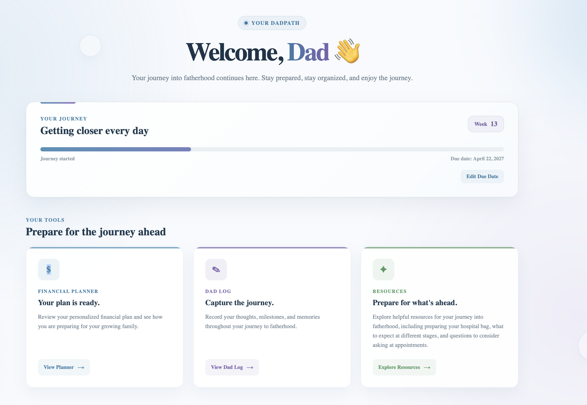
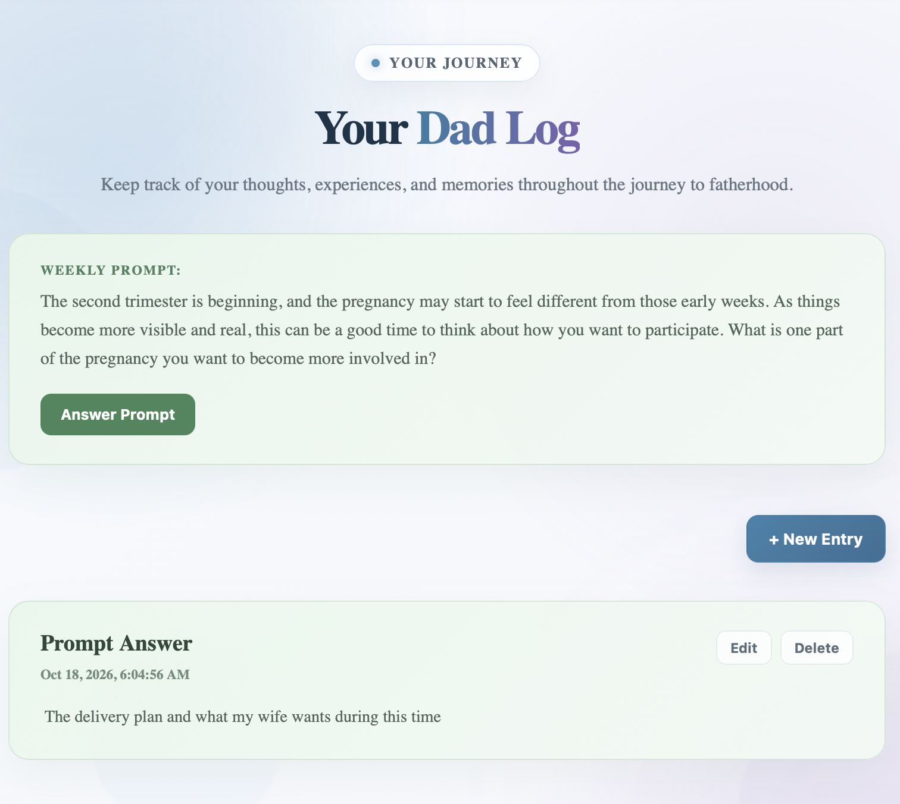

# DadPath

### Senior Capstone Project | Grand Canyon University

[](https://dad-path.vercel.app)

DadPath is a full-stack web application designed to help expecting fathers prepare for parenthood through personal journaling, financial planning, and a centralized dashboard.

Developed as a Senior Capstone Project at Grand Canyon University, DadPath addresses the need for a centralized resource where expecting fathers can organize their thoughts, track personal reflections, and prepare financially for the responsibilities of parenthood.

---

## Project Background

Preparing for parenthood involves significant personal, financial, and organizational changes. DadPath was developed to provide expecting fathers with a centralized application to support these preparations.

The project was designed around three primary areas: personal organization, journaling, and financial planning.

## Key Features

### Dashboard

Provides a centralized starting point for users to access the application's primary features.

### Dad Log

Allows users to create and save personal journal entries, providing a dedicated space for recording thoughts and reflections throughout the transition to fatherhood.

### Financial Planner

Provides an interactive questionnaire to help users consider financial preparations for parenthood. Responses are saved and can be revisited and edited.

### Authentication

Supports user registration and login, with password hashing and JWT-based authentication to protect user-specific information.

---

## Technology Stack

| Component | Technology |
|---|---|
| Frontend | Angular |
| Backend | Java, Spring Boot |
| Database | PostgreSQL |
| Authentication | JWT, BCrypt |
| Build Tool | Maven |
| Frontend Hosting | Vercel |
| Backend Hosting | Railway |
| Version Control | Git, GitHub |

## Implementation Approach

DadPath was developed using an Agile-inspired iterative development approach. Development was organized around individual application features, allowing functionality to be implemented, reviewed, tested, and refined throughout the project.

The frontend and backend were developed separately and integrated through REST APIs. Spring Boot handles application logic, authentication, and database operations, while Angular provides the user interface and communicates with the backend.

## System Architecture

DadPath follows a client-server architecture:

- **Frontend:** Angular handles the user interface and user interactions.
- **Backend:** Spring Boot exposes REST endpoints, processes requests, and applies application logic.
- **Database:** PostgreSQL stores user accounts, journal entries, and financial planner responses.
- **Authentication:** JWT-based authentication secures protected API requests, while BCrypt handles password hashing.


## Supporting Artifacts

- [Showcase Poster](Showcase%20Poster.pdf)
- [Final Architectural Plan](Final%20Architectural%20Plan.pdf)

---

## Code Highlights

The following examples demonstrate important implementation concepts used throughout DadPath. These examples are taken from the application's backend service and security layers.

### 1. Authentication and Security

JWT authentication is used to protect application endpoints and associate incoming requests with authenticated users. The authentication filter extracts and validates the token, retrieves the corresponding user details, and establishes the authentication context for the request. BCrypt is used separately to securely hash passwords.

```java
// Called for every request that comes to the server.
// It extracts the JWT token from the request, validates it, and sets the user's authentication in the SecurityContext.
@Override
protected void doFilterInternal(HttpServletRequest request, HttpServletResponse response, FilterChain filterChain) throws ServletException, IOException
{
    // extract the JWT token from the request
    String jwt = getJwtFromRequest(request);

    // validate the token
    if (jwt != null && jwtTokenProvider.validateToken(jwt))
    {
        String username = jwtTokenProvider.getUsernameFromJWT(jwt);

        // load the user details from the database
        UserDetails userDetails = userDetailsService.loadUserByUsername(username);

        if (userDetails != null)
        {
            // create an authentication object
            UsernamePasswordAuthenticationToken authentication = new UsernamePasswordAuthenticationToken(
            userDetails, null, userDetails.getAuthorities());
            authentication.setDetails(new WebAuthenticationDetailsSource().buildDetails(request));

            // set the authentication object in the SecurityContext
            SecurityContextHolder.getContext().setAuthentication(authentication);
        }
    }

    // continue the filter chain
    filterChain.doFilter(request, response);
}
```

### 2. Dad Log Data Persistence

The Dad Log feature uses the Spring Boot backend to process journal entries and persist them in PostgreSQL. The service associates each entry with the appropriate user, assigns timestamps, saves the entity through the repository, and converts the saved record into a DTO for the response.

```java
// Create
public DadlogDTO create(DadlogDTO dto, Long userId)
{
    DadlogEntity entity = new DadlogEntity();

    entity.setUserId(userId);
    entity.setTitle(dto.getTitle());
    entity.setContent(dto.getContent());
    entity.setPrompt(dto.getPrompt());

    entity.setCreatedAt(LocalDateTime.now());
    entity.setUpdatedAt(LocalDateTime.now());

    DadlogEntity saved = dadlogRepository.save(entity);

    return dadlogMapper.toDTO(
        dadlogMapper.toModel(saved)
    );
}
```

### 3. Financial Planner Persistence

The Financial Planner stores questionnaire responses as JSON, allowing users to save their answers and retrieve them when returning to the planner. The service checks whether a planner already exists for the user, creates one when necessary, and serializes submitted responses before saving them to PostgreSQL.

```java
public PlannerEntity getOrCreate(String userId)
{
    // Retrieve user's planner or create a new one
    return repo.findByUserId(userId)
            .orElseGet(() ->
            {
                PlannerEntity p = new PlannerEntity();
                p.setUserId(userId);
                p.setAnswersJson("{}");
                return repo.save(p);
            });
}

public PlannerEntity saveAll(String userId, Map<String, Object> newAnswers)
{
    try
    {
        PlannerEntity planner = getOrCreate(userId);

        // Convert submitted planner answers to JSON before saving
        planner.setAnswersJson(
            objectMapper.writeValueAsString(newAnswers)
        );

        return repo.save(planner);

    }
    catch (JsonProcessingException e)
    {
        // Handle errors occurring while converting answers to JSON
        throw new RuntimeException("Failed to serialize answers JSON", e);
    }
}
```

---

## Application Screenshots

### Dashboard



### Dad Log



### Financial Planner


---

## Project Demonstration

A screencast presentation demonstrating the completed application, its primary functionality, implementation approach, and development challenges.

**[Watch the DadPath Project Demonstration](https://www.loom.com/share/1ab0a165e85e493fba8f3d6492d99067)**

---

## Accessing the Application

- **Live Application:** [https://dad-path.vercel.app](https://dad-path.vercel.app)
- **Backend API:** [https://dad-path-production.up.railway.app](https://dad-path-production.up.railway.app)
- **Private Source Repository:** [https://github.com/pybdrew/dad-path](https://github.com/pybdrew/dad-path)
---

## Project Information

**Institution:** Grand Canyon University  
**Program:** Bachelor of Science in Software Development  
**Course:** Senior Capstone Project (CST-451 / CST-452)  
**Development Approach:** Agile-Inspired Iterative Development